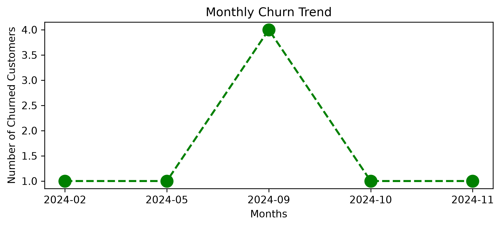
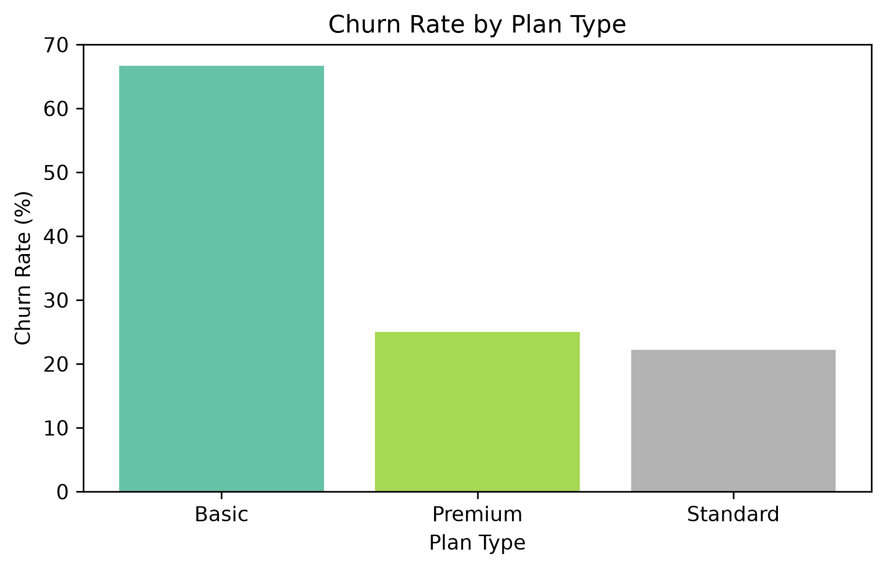
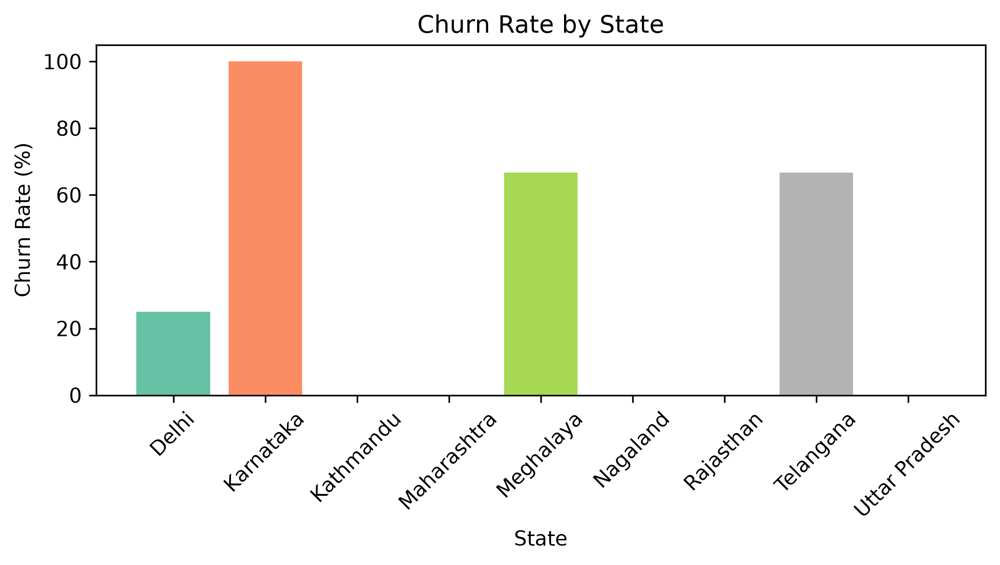
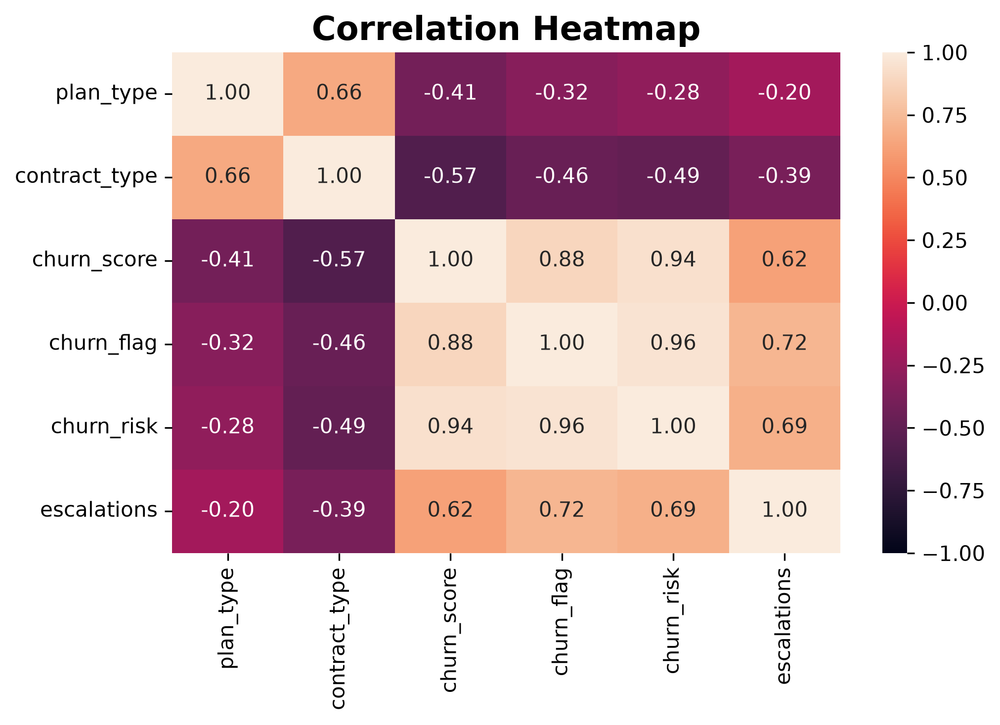

# 📊 Customer Churn Analysis
### Turning Customer Data into Actionable Business Insights

<p align="center">
  <strong>Exploratory Data Analysis | Customer Retention | Business Intelligence</strong>
</p>

<p align="center">
  
  
  
  
  
</p>

## 🎯 Project Overview

Customer churn directly affects recurring revenue and long-term business growth. This project uses **SQL, Python, and exploratory data analysis** to examine customer behavior, identify segments with higher observed churn, and translate analytical patterns into practical retention recommendations.

Rather than focusing only on visualizations, the project connects data exploration with real business questions around subscription plans, customer tenure, geographical patterns, and support escalations.

**Project focus:** Understand what the data reveals, identify patterns worth investigating, and support more informed customer-retention decisions.


## 🧰 Tools & Technologies

`Python` · `SQL` · `SQLite` · `Pandas` · `NumPy` · `Matplotlib` · `Jupyter Notebook`

## 📌 What I Explored

| Analysis | Business Question |
|---|---|
| **Churn & Retention** | How can customer churn be measured and monitored? |
| **Monthly Churn Trends** | How does churn change over time? |
| **Plan-wise Analysis** | Which subscription plans have comparatively higher churn? |
| **Geographical Analysis** | How does churn vary across states? |
| **Customer Tenure** | How long do customers stay with the service? |
| **Support Escalations** | Is there an association between escalations and churn? |
| **Churn Risk Segmentation** | How can customers be grouped by their churn scores? |

## ⚙️ My Analysis Workflow

**01 — Extract**  
Queried the SQLite database and loaded the available tables into Pandas for analysis.

**02 — Prepare**  
Inspected the data, reviewed relevant columns, and prepared variables for meaningful comparisons.

**03 — Analyze**  
Calculated churn-related metrics and investigated patterns across time, subscription plans, locations, tenure, and customer support.

**04 — Visualize**  
Created charts using Matplotlib to make trends and differences easier to interpret.

**05 — Interpret**  
Connected the analytical results to business questions and developed practical recommendations for customer retention.

## 💡 From Analysis to Action

The analysis connects customer behavior with potential business actions:

- **Retention campaigns:** Prioritize customer groups with higher observed churn rates.
- **Subscription strategy:** Investigate plan-level differences before making pricing or product decisions.
- **Better support experiences:** Examine escalation patterns to identify possible customer pain points.
- **Proactive engagement:** Use churn-risk categories to organize customer outreach.
- **Performance tracking:** Monitor churn trends over time to assess whether retention initiatives are working.

These are analysis-driven opportunities to investigate, rather than assumptions that any single factor directly causes churn.

## 🧠 What This Project Demonstrates

- Writing SQL queries and working with a relational database
- Data inspection, manipulation, and analysis with Pandas and NumPy
- Calculating business metrics from customer data
- Exploratory data analysis and visualization
- Comparing customer segments and interpreting trends
- Communicating analytical findings through business-oriented recommendations

## 📊 Visual Insights

<table>
  <tr>
    <td align="center" width="50%">
      <strong>Monthly Churn Trend</strong><br><br>
      
    </td>
    <td align="center" width="50%">
      <strong>Churn Rate by Plan Type</strong><br><br>
      
    </td>
  </tr>
  <tr>
    <td align="center" width="50%">
      <strong>Churn Rate by State</strong><br><br>
      
    </td>
    <td align="center" width="50%">
      <strong>Correlation Heatmap</strong><br><br>
      
    </td>
  </tr>
</table>


## 🚀 Run It Locally

**1. Clone the repository**

```bash
git clone https://github.com/saloniagarw/Customer-Churn-Analysis.git
cd Customer-Churn-Analysis
```

**2. Install the required libraries**

```bash
pip install pandas numpy matplotlib jupyter
```

**3. Add the database**

Place `customer_churn.db` in the location expected by the notebook. Update the database path if necessary.

**4. Launch Jupyter Notebook**

```bash
jupyter notebook
```

Open `Customer_Churn_Analysis.ipynb` and run the cells in sequence.

## 🔭 What I Would Explore Next

- Build an interactive dashboard for tracking churn KPIs
- Analyze customer lifetime value and revenue at risk
- Investigate additional factors associated with customer churn
- Develop and evaluate a machine learning model for churn prediction

## 👩‍💻 About

**Saloni Agarwal**

GitHub: [@saloniagarw](https://github.com/saloniagarw)

---

*Built with curiosity, data, and a focus on turning analysis into actionable insights.*
